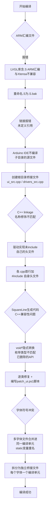

# PCDash — LVGL v9.3 移植记录

> **项目**: PCDash ESP32-S3 PC 监控屏  
> **硬件**: ESP32-S3 + ILI9341 320×240 TFT  
> **编译环境**: Arduino IDE 2.x + ESP32 Arduino Core 3.3.10  
> **LVGL 版本**: v9.3（Arduino 库）  
> **UI 设计工具**: SquareLine Studio 1.6.1  
> **记录时间**: 2026-06

---

## 一、背景

本项目使用 SquareLine Studio 1.6.1 设计 UI，导出为 LVGL v9.3 格式的 `.c` 源文件，在 Arduino IDE 中为 ESP32-S3 编译。移植过程中遭遇了一系列问题，涉及 LVGL 库配置、Arduino 编译机制、C/C++ 混合编译兼容性等多个层面。

---

## 二、总体问题链



---

## 三、问题详解与解决方案

### 问题 1：LVGL 库含 ARM 汇编文件，Xtensa 不认识

**现象**
```
cc1: error: unrecognized command-line option '-mfpu=neon'
lv_blend_neon.S: Assembler messages: Error
```

**原因**  
LVGL 库为了在 ARM Cortex-M/A 上提速，包含了 NEON/Helium 汇编优化文件（`.S`）。ESP32-S3 使用 Xtensa LX7 架构，工具链不认识这些文件。

**解决方案**  
在编译机上将 LVGL 库目录中的冲突文件改名，让 IDE 忽略它们：

```powershell
# 路径: C:\Users\<用户>\Documents\Arduino\libraries\lvgl\src\draw\sw\blend\
Rename-Item lv_blend_neon.S    lv_blend_neon.S.bak
Rename-Item lv_blend_helium.S  lv_blend_helium.S.bak

# Wayland 驱动目录也含不兼容代码
Rename-Item wayland  wayland_disabled
```

---

### 问题 2：Arduino IDE 不编译子目录中的源文件

**现象**
```
undefined reference to `ui_init'
undefined reference to `lv_port_disp_init'
```

**原因**  
Arduino IDE 的编译规则：**只编译 sketch 根目录下的 `.ino`、`.c`、`.cpp` 文件**。子目录（`ui/`、`drivers/`）中的源文件被完全忽略。

> 唯一例外：`src/` 子目录会被自动编译（视为库的标准源目录）。

**项目目录结构**
```
PCDash/                     ← sketch 根目录（Arduino 只编译此层）
├── PCDash.ino
├── ui/                     ← SquareLine 导出目录（不被编译）
│   ├── ui.c
│   ├── ui_scrmain.c
│   └── ...
└── drivers/                ← 驱动目录（不被编译）
    ├── lv_port_disp.cpp
    └── lv_port_indev.cpp
```

**解决方案：创建根目录桥接文件**

在 sketch 根目录创建 `.cpp` 文件，通过 `#include` 强制拉入子目录源文件，使其成为桥接文件所在编译单元的一部分：

```cpp
// ui_src.cpp — UI 桥接文件
#include "ui/ui.c"
#include "ui/ui_scrmain.c"
#include "ui/ui_helpers.c"
#include "ui/ui_comp.c"
#include "ui/ui_comp_hook.c"
#include "ui/ui_comp_pnl_statusbar.c"
```

```cpp
// drivers_src.cpp — 驱动桥接文件
#include "drivers/lv_port_disp.cpp"
#include "drivers/lv_port_indev.cpp"
```

**原理**：GCC 编译 `ui_src.cpp` 时，`#include "ui/ui.c"` 将 `ui.c` 的内容完整嵌入当前编译单元，内部的相对路径引用（如 `#include "ui.h"`）仍以 `ui.c` 所在目录为基准，正确解析。

---

### 问题 3：C++ 名称修饰（Name Mangling）导致链接失败

**现象**
```
undefined reference to `lv_port_disp_init'    ← 调用方期望 C linkage
```

**原因**  
C++ 编译器对函数名进行名称修饰（mangling），使其包含参数类型信息。C 编译器不做修饰。当调用方（通过 `extern "C"` 头文件）期望 C linkage 的符号，而实现方以 C++ linkage 定义时，链接器找不到匹配符号。

**问题根源**：`lv_port_disp.cpp` 和 `lv_port_indev.cpp` 没有 `#include` 自身头文件，函数定义以 C++ linkage 生成，但调用方通过 `lv_port_disp.h`（含 `extern "C"`）期望 C linkage。

**解决方案**：在实现文件首行加入自身头文件

```cpp
// lv_port_disp.cpp — 在所有其他 include 之前
#include "lv_port_disp.h"   // ← 新增：先声明，定义自动继承 C linkage
#include <lvgl.h>
#include <TFT_eSPI.h>
```

```cpp
// lv_port_indev.cpp
#include "lv_port_indev.h"  // ← 新增
#include <lvgl.h>
#include <TFT_Touch.h>
```

**机制**：C++ 规定，若函数在定义前已有 `extern "C"` 声明，则定义自动继承 C linkage。

**附加问题**：`lv_port_disp.h` 中使用了 `uint8_t`，但首次被包含时 `<stdint.h>` 尚未引入：

```c
// lv_port_disp.h — 加入 stdint.h
#ifndef LV_PORT_DISP_H
#define LV_PORT_DISP_H

#include <stdint.h>   // ← 新增：保证 uint8_t 可用

#ifdef __cplusplus
extern "C" {
#endif
void lv_port_disp_init(void);
void lv_port_disp_set_brightness(uint8_t level);
#ifdef __cplusplus
}
#endif
#endif
```

---

### 问题 4：SquareLine 生成的 C 代码在 C++ 编译模式下的兼容性

由于桥接文件（`.cpp`）以 C++ 模式编译，包含的 `.c` 文件也按 C++ 规则处理。C++ 比 C 更严格，暴露出以下问题：

#### 4-1 `void*` 不能隐式转换为具体指针类型

| 文件 | 原代码 | 修复 |
|------|--------|------|
| `ui_comp.c` | `lv_obj_t ** c = lv_event_get_user_data(e);` | `(lv_obj_t **)lv_event_get_user_data(e)` |
| `ui_comp.c` | `ui_comp_get_child_t * info = lv_event_get_param(e);` | `(ui_comp_get_child_t *)lv_event_get_param(e)` |
| `ui_comp_pnl_statusbar.c` | `lv_obj_t ** children = lv_malloc(...);` | `(lv_obj_t **)lv_malloc(...)` |
| `ui_helpers.c` | `screen_destroy_cb_t destroy_cb = lv_event_get_user_data(e);` | `(screen_destroy_cb_t)lv_event_get_user_data(e)` |

#### 4-2 `int32_t` 不能隐式转换为枚举类型

```c
// ui_helpers.c — _ui_flag_modify 函数
// 原始代码（C 允许，C++ 报错）
lv_obj_has_flag(target, flag)        // flag 是 int32_t，参数期望 lv_obj_flag_t

// 修复：显式强转
lv_obj_has_flag(target, (lv_obj_flag_t)flag)
lv_obj_remove_flag(target, (lv_obj_flag_t)flag)
lv_obj_add_flag(target, (lv_obj_flag_t)flag)
```

#### 4-3 自定义事件码类型不匹配

```c
// ui_comp.c — LV_EVENT_GET_COMP_CHILD 是 uint32_t 变量
// lv_obj_send_event 第二个参数期望 lv_event_code_t 枚举
lv_obj_send_event(comp, (lv_event_code_t)LV_EVENT_GET_COMP_CHILD, &info);

// ui_comp_pnl_statusbar.c
lv_obj_add_event_cb(..., (lv_event_code_t)LV_EVENT_GET_COMP_CHILD, children);
```

#### 4-4 LVGL v9 中已删除的 API

SquareLine 1.6.1 生成的 `ui_helpers.c` 中包含 v8 时代的 textarea 光标移动 API，在 v9 中已彻底移除：

```c
// 这些函数在 LVGL v9 中不存在，无法恢复
lv_textarea_cursor_up(target);
lv_textarea_cursor_right(target);
lv_textarea_cursor_down(target);
lv_textarea_cursor_left(target);
```

#### 4-5 未在 `lv_conf.h` 中启用的 Widget API

SquareLine 生成的 `ui_helpers.c` 包含所有 widget 类型的辅助函数，但本项目 `lv_conf.h` 中关闭了大部分 widget。

**受影响的 API**（函数存在于 LVGL v9，但需 `lv_conf.h` 开启对应 widget）：

| API | 需要开启 |
|-----|---------|
| `lv_dropdown_set_selected` | `LV_USE_DROPDOWN 1` |
| `lv_roller_set_selected` | `LV_USE_ROLLER 1` |
| `lv_slider_set_value/get_value` | `LV_USE_SLIDER 1` |
| `lv_keyboard_set_textarea` | `LV_USE_KEYBOARD 1` |
| `lv_spinbox_increment/decrement` | `LV_USE_SPINBOX 1` |

**解决方案**：用 LVGL 标准预处理宏保护函数体，widget 未启用时函数体为空：

```c
void _ui_dropdown_set_property(lv_obj_t * target, int id, int val)
{
#if LV_USE_DROPDOWN
    if(id == _UI_DROPDOWN_PROPERTY_SELECTED) lv_dropdown_set_selected(target, val);
#endif
}
```

---

### 问题 5：多字体文件合并进同一编译单元导致 static 变量冲突

**现象**
```
error: redefinition of 'const uint8_t glyph_bitmap []'
error: redefinition of 'const lv_font_fmt_txt_glyph_dsc_t glyph_dsc []'
```

**原因**  
SquareLine 生成的每个字体 `.c` 文件内部都定义了同名的 `static` 变量（`glyph_bitmap`、`glyph_dsc`、`cmaps`、`font_dsc`）。`static` 的本意是文件作用域隔离，但当三个字体文件都被 `#include` 进同一个 `ui_src.cpp` 时，它们合并成**一个编译单元**，三份同名定义直接冲突。

```
ui_src.cpp (一个编译单元)
├── #include "ui/ui_font_fangsong12.c"  → static glyph_bitmap[1655]
├── #include "ui/ui_font_fangsong14.c"  → static glyph_bitmap[???]  ← 冲突!
└── #include "ui/ui_font_yahei14.c"     → static glyph_bitmap[???]  ← 冲突!
```

**解决方案**：每个字体独立一个编译单元

```
font_fangsong12.cpp  →  #include "ui/ui_font_fangsong12.c"
font_fangsong14.cpp  →  #include "ui/ui_font_fangsong14.c"
font_yahei14.cpp     →  #include "ui/ui_font_yahei14.c"
```

从 `ui_src.cpp` 中移除字体 include，三个字体各自拥有独立编译单元，`static` 隔离恢复正常。

---

### 问题 6：字体符号未在 `lv_conf.h` 中启用，且被项目本地的同名文件遮蔽

**现象**
```
error: 'lv_font_montserrat_48' was not declared in this scope
```

修改系统库里的 `lv_conf.h` 后重新编译，错误依然存在。

**原因（两层）**

第一层：SquareLine 在 UI 设计时选用了 Montserrat 48pt 字体，但 `lv_conf.h` 中该字体宏未开启（默认为 `0`）。

第二层（更隐蔽）：Arduino IDE 的头文件搜索顺序以 **sketch 根目录最优先**：

```
1. sketch 根目录         ← PCDash\lv_conf.h        ✅ 最先命中
2. sketch 子目录
3. 系统库目录            ← libraries\lv_conf.h     （被跳过）
4. Arduino 平台库
```

项目根目录里存在一份旧的 `lv_conf.h`（`LV_FONT_MONTSERRAT_48 0`），完全屏蔽了系统库里已修改的版本，导致即使改了系统库也不生效。

**解决方案**

在**项目根目录的** `lv_conf.h` 中启用字体：

```c
// PCDash\lv_conf.h
#define LV_FONT_MONTSERRAT_48  1   // 0 → 1
```

> **关于两套 `lv_conf.h` 的策略**  
> - 项目根目录保留 `lv_conf.h`：各项目独立配置，互不影响（推荐多项目场景）  
> - 删掉项目根目录的 `lv_conf.h`：统一使用系统库配置，只需维护一份

> **Flash 代价**：Montserrat 48pt 约占用额外 30～40KB Flash，ESP32-S3（≥4MB Flash）完全可以承受。

**改配置后必须清库缓存**

Arduino IDE 只监测库 `.c/.cpp` 源文件的变化，**不监测** `lv_conf.h` 的变化。改完配置后必须手动清除库编译缓存，否则 IDE 使用旧的编译结果，改动不生效：

```powershell
# 清除 Arduino 库缓存（在编译机上执行）
Remove-Item -Recurse -Force "$env:LOCALAPPDATA\arduino\libraries" -ErrorAction SilentlyContinue
Remove-Item -Recurse -Force "$env:LOCALAPPDATA\arduino\cores"    -ErrorAction SilentlyContinue
```

---

## 四、最终文件结构

```
PCDash/                         ← Arduino Sketch 根目录
├── PCDash.ino                  ← 主入口
├── app_binddata.cpp            ← 数据绑定层（手写）
├── app_binddata.h
├── ui_events.cpp               ← 事件回调（手写）
├── data_hub.ino                ← 数据中心
├── data_model.h                ← 数据模型
├── config.h
│
├── ui_src.cpp                  ← [桥接] UI 文件编译入口
├── drivers_src.cpp             ← [桥接] 驱动文件编译入口
├── font_fangsong12.cpp         ← [桥接] 字体独立编译单元
├── font_fangsong14.cpp         ← [桥接] 字体独立编译单元
├── font_yahei14.cpp            ← [桥接] 字体独立编译单元
│
├── patch_ui.ps1                ← [工具] SquareLine导出后补丁脚本
│
├── ui/                         ← SquareLine 导出目录（不被IDE直接编译）
│   ├── ui.c
│   ├── ui_scrmain.c
│   ├── ui_helpers.c            ← 含C++兼容补丁
│   ├── ui_comp.c               ← 含C++兼容补丁
│   ├── ui_comp_hook.c
│   ├── ui_comp_pnl_statusbar.c ← 含C++兼容补丁
│   ├── ui_font_fangsong12.c
│   ├── ui_font_fangsong14.c
│   └── ui_font_yahei14.c
│
└── drivers/                    ← 驱动目录（不被IDE直接编译）
    ├── lv_port_disp.cpp        ← 首行加 #include "lv_port_disp.h"
    ├── lv_port_disp.h          ← 含 stdint.h + extern "C"
    ├── lv_port_indev.cpp       ← 首行加 #include "lv_port_indev.h"
    └── lv_port_indev.h
```

---

## 五、关键经验总结

### 5-1 Arduino IDE 编译作用域与头文件优先级

**源文件编译范围**
```
只编译根目录:  *.ino / *.c / *.cpp
自动编译:      src/ 子目录（视为库）
不编译:        其他所有子目录（ui/、drivers/ 等）
```

**规避方案**：在根目录建桥接 `.cpp` 文件 `#include` 子目录源文件。

**头文件搜索优先级**
```
1. sketch 根目录    ← 最高优先级，会遮蔽同名的系统库头文件
2. sketch 子目录
3. 第三方库目录
4. Arduino 平台库
```

> 若项目根目录存在 `lv_conf.h`，它会完全屏蔽系统库里的同名文件。  
> 修改配置时务必确认改的是**实际被编译器加载的那一份**。

### 5-2 C++ 比 C 更严格的三个关键点

| C 允许 | C++ 行为 | 解决 |
|--------|---------|------|
| `void*` 赋给任意指针 | 报错 | 显式强转 `(T*)ptr` |
| 整数赋给枚举 | 报错 | 显式强转 `(enum_t)val` |
| 函数隐式声明 | 报错 | 提供前置声明或头文件 |

### 5-3 extern "C" linkage 最佳实践

```cpp
// 头文件（正确模板）
#include <stdint.h>
#ifdef __cplusplus
extern "C" {
#endif
void my_func(uint8_t param);
#ifdef __cplusplus
}
#endif

// 实现文件（关键：首行 include 自身头文件）
#include "my_header.h"   // ← 必须在最前，使定义继承 C linkage
#include <other_libs.h>
```

### 5-4 static 变量的编译单元隔离

`static` 全局变量/函数的作用域是**编译单元**（Translation Unit），而非源文件。当多个 `.c` 文件被 `#include` 进同一 `.cpp`，它们共享同一编译单元，`static` 隔离失效。

**解决**：多个有同名 `static` 变量的源文件，必须各自对应独立的桥接文件。

### 5-5 SquareLine 重新导出后的补丁维护

SquareLine 重新导出会覆盖 `ui/` 目录下所有文件，导致手工补丁丢失。解决方案：

```
每次重新导出后执行:  .\patch_ui.ps1
```

脚本幂等设计，已打补丁的行自动跳过，新增组件文件（`ui_comp_*.c`）自动处理。

---

## 六、LVGL v9 相比 v8 的已知 API 变化（本项目遇到的）

| API（v8） | v9 状态 | 说明 |
|-----------|---------|------|
| `lv_textarea_cursor_up/right/down/left` | **已删除** | textarea 光标移动 API 重构 |
| `lv_slider_set_value` | 存在，需启用 widget | `LV_USE_SLIDER 1` |
| `lv_obj_remove_flag` / `lv_obj_add_flag` | 参数类型更严格 | 需 `lv_obj_flag_t` 枚举，不接受 `int` |
| `lv_event_get_user_data` / `lv_event_get_param` | 返回 `void*` | C++ 下需显式转换 |
| `lv_screen_load_anim` | 新 API | 替代旧版加载方式 |
| `lv_image_set_src` / `lv_image_set_scale` | 新命名 | `lv_img_*` 改为 `lv_image_*` |
