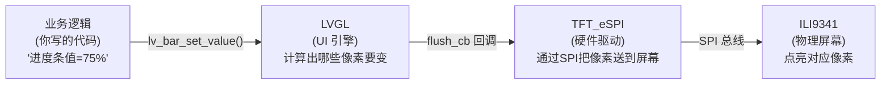
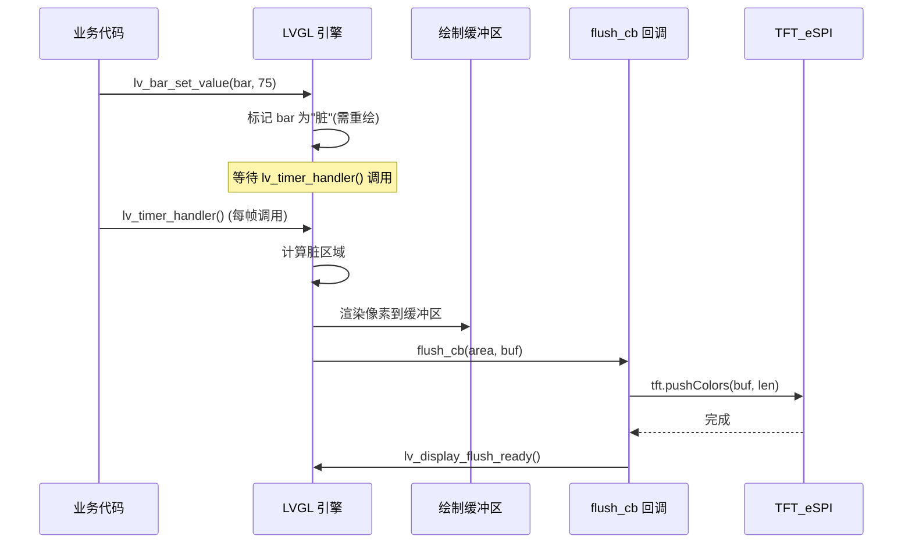
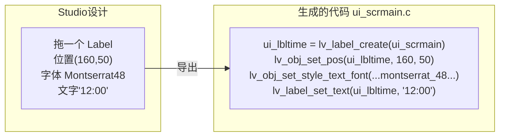
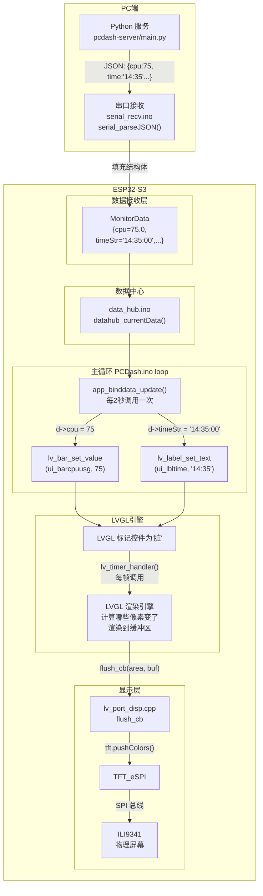
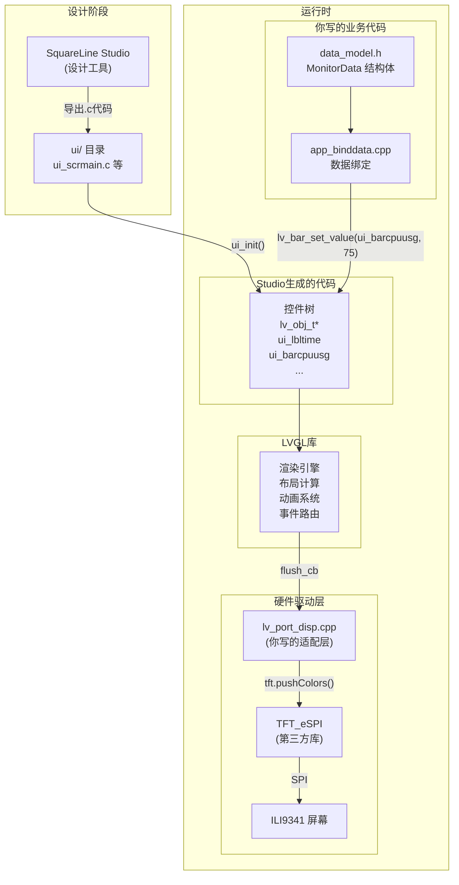

# LVGL 学习指南 — 以 PCDash 项目为例

> 写给 LVGL 新手。本文不讲抽象概念，而是以 PCDash（ESP32-S3 PC监控屏）为具体案例，
> 从"这个系统到底在干什么"出发，逐层拆解每个组件的职责和它们之间的协作关系。

---

## 一、先建立大局观

在学任何细节之前，先回答一个问题：**这套系统做了一件什么事？**

```
PC 的 CPU/GPU 数据  →  通过串口  →  ESP32-S3  →  显示在 TFT 屏幕上
```

听起来简单，但"显示在屏幕上"这四个字背后藏着整个系统的复杂度。屏幕是一块物理硬件，它只认识"第 X 行第 Y 列画一个什么颜色的点"这种命令。而我们想要的是"显示一个进度条，值是 75%，颜色是蓝色，带圆角"。

**从"我想要一个进度条"到"第X行第Y列画蓝色像素"，中间隔了三层翻译：**



这就是整个系统的骨架。下面逐层拆解。

---

## 二、最底层：TFT_eSPI — 像素搬运工

### 它是什么

TFT_eSPI 是一个 Arduino 库，专门负责和 TFT 液晶屏幕的底层通信。

屏幕控制芯片（本项目是 ILI9341）通过 SPI 总线接收命令。TFT_eSPI 封装了所有这些底层 SPI 协议细节，给上层提供简单的函数，比如：

```cpp
tft.fillRect(x, y, w, h, color);   // 画一个填充矩形
tft.drawPixel(x, y, color);        // 画单个像素
tft.pushColors(buf, len, true);     // 批量推送一块像素数据
```

### 它不知道什么

TFT_eSPI **完全不知道** "进度条"、"标签"、"字体" 这些概念。它只会画像素。你如果想用纯 TFT_eSPI 画一个进度条，你需要自己计算每个像素的坐标和颜色，手动调用 fillRect。这很繁琐，而且你还要自己处理"数值变了之后如何只重绘变化的部分"这类效率问题。

**TFT_eSPI 是工具，不是框架。**

---

## 三、中间层：LVGL — UI 引擎

### 它解决了什么问题

LVGL 在 TFT_eSPI 之上建立了一套**完整的 GUI 框架**，让你可以用"控件"（Widget）的概念来编程，而不是像素：

```cpp
// 不用这样（纯像素操作）:
tft.fillRect(10, 10, 200, 20, 0x001F);  // 画蓝色矩形
tft.fillRect(10, 10, 150, 20, 0xF800);  // 画75%处的红色

// 而是这样（LVGL 控件）:
lv_obj_t* bar = lv_bar_create(screen);
lv_bar_set_value(bar, 75, LV_ANIM_ON);  // LVGL 自动算出怎么画
```

### LVGL 的核心工作模式

LVGL 是一个**保留模式 GUI**（Retained Mode GUI）。这意味着：

1. 你创建控件，LVGL 在内存里维护一棵"控件树"
2. 你修改控件属性（文字、数值、颜色）
3. LVGL 自动标记"这个控件变了，需要重绘"
4. 在下一个渲染周期，LVGL 计算出哪些像素变了，只重绘那部分
5. 把渲染结果（一块像素数据）交给你指定的"刷新回调函数"



### LVGL 的控件树

LVGL 里所有东西都是 `lv_obj_t`（对象），组成一棵树：

```
Screen (屏幕，根节点)
├── Panel (面板)
│   ├── Label "CPU"
│   ├── Bar (进度条，CPU使用率)
│   └── Label "75%"
├── Panel (另一个面板)
│   └── ...
└── Label (时间显示)
```

父节点裁剪子节点（子控件不会超出父容器显示），父节点移动时子节点跟随移动。

### LVGL 需要你提供什么

LVGL 是个"引擎"，不关心你用什么硬件。你需要告诉它两件事：

1. **显示驱动**（Display Driver）：渲染好的像素数据应该发给谁
2. **输入驱动**（Input Driver）：触摸/按键事件从哪里来

这就是 `lv_port_disp.cpp` 和 `lv_port_indev.cpp` 干的事。

---

## 四、胶合层：lv_port_disp.cpp — 连接 LVGL 与 TFT_eSPI

这个文件是整个项目最关键的"胶水"，它把 LVGL 和 TFT_eSPI 粘在一起。

### 它做了三件事

```cpp
// lv_port_disp.cpp 简化版，帮助理解

void lv_port_disp_init(void) {

    // ① 创建 LVGL 显示对象，告诉 LVGL 屏幕是 320×240
    lv_display_t* disp = lv_display_create(320, 240);

    // ② 分配绘制缓冲区（LVGL 渲染到这里）
    //    不需要整屏大小，LVGL 会分块渲染
    static lv_color_t buf[320 * 10];  // 10行缓冲（约6KB）
    lv_display_set_buffers(disp, buf, NULL, sizeof(buf),
                           LV_DISPLAY_RENDER_MODE_PARTIAL);

    // ③ 注册刷新回调：LVGL 渲染完一块后调用这个函数
    lv_display_set_flush_cb(disp, flush_cb);
}

// LVGL 渲染完成后调用这里
static void flush_cb(lv_display_t* disp,
                     const lv_area_t* area,
                     uint8_t* px_map) {
    // area 告诉我们这块像素覆盖屏幕的哪个矩形区域
    // px_map 是已渲染好的像素数据

    // 告诉 TFT_eSPI 把这块数据写到屏幕的对应位置
    tft.startWrite();
    tft.setAddrWindow(area->x1, area->y1,
                      area->x2 - area->x1 + 1,
                      area->y2 - area->y1 + 1);
    tft.pushColors((uint16_t*)px_map, pixel_count, true);
    tft.endWrite();

    // 告诉 LVGL：这块已经刷完了，可以继续
    lv_display_flush_ready(disp);
}
```

### 分块渲染的意义

注意缓冲区只有 10 行（320×10 = 3200 个像素）。LVGL 不需要整屏缓冲，它把屏幕分成多个小块，一块一块地渲染和发送。这就是嵌入式 GUI 能在 RAM 极其有限的设备上运行的核心技巧。

```
屏幕 320×240
┌─────────────────┐
│    第1块(10行)   │ ← LVGL渲染 → flush_cb → TFT_eSPI
├─────────────────┤
│    第2块(10行)   │ ← LVGL渲染 → flush_cb → TFT_eSPI
├─────────────────┤
│      ...        │
└─────────────────┘
```

---

## 五、SquareLine Studio — UI 设计导出的代码做了什么

### Studio 的定位

SquareLine Studio 是一个**所见即所得的 LVGL UI 设计工具**。你在 Studio 里拖拽放置控件、设置样式、配置动画，Studio 帮你生成相应的 LVGL C 代码。

它解决的问题是：**手写 LVGL 布局代码很枯燥，而且改一个控件位置要重新计算坐标。**

### Studio 生成了什么

Studio 导出后，`ui/` 目录里的文件本质上只做一件事：**用代码重现你在设计工具里摆放的那棵控件树**。



### 关键：全局控件指针变量

Studio 为每个控件生成一个**全局指针变量**，命名规则是 `ui_控件名`：

```c
// ui/ui.h（Studio生成的头文件）
extern lv_obj_t* ui_scrmain;        // 主屏幕
extern lv_obj_t* ui_lbltime;        // 时间标签
extern lv_obj_t* ui_barcpuusg;     // CPU使用率进度条
extern lv_obj_t* ui_lblcpuusgval;  // CPU使用率数值文字
extern lv_obj_t* ui_bargpuusg;     // GPU使用率进度条
// ... 所有控件都有对应的全局变量
```

```c
// ui/ui_scrmain.c（Studio生成的实现）
lv_obj_t* ui_lbltime = NULL;    // 初始为空

void ui_scrmain_screen_init(void) {
    // 调用后，指针才指向真实的控件对象
    ui_lbltime = lv_label_create(ui_scrmain);
    lv_obj_set_pos(ui_lbltime, 160, 50);
    lv_label_set_text(ui_lbltime, "12:00");  // 初始文字是占位符
    // ...
}
```

**这些全局指针是业务代码与 UI 代码交互的唯一接口。**

### ui_init() 是总入口

```c
// ui/ui.c（Studio生成）
void ui_init(void) {
    ui_scrmain_screen_init();   // 创建主屏幕的所有控件
    lv_screen_load(ui_scrmain); // 把主屏幕加载为当前显示屏幕
}
```

在 `PCDash.ino` 的 `setup()` 里调用 `ui_init()`，之后所有控件就都建好了，全局指针也都有效了。

---

## 六、业务逻辑代码如何与 UI 交互 — 数据绑定

### 数据绑定的本质

"数据绑定"听起来高大上，其实本质极其简单：

**就是调用 LVGL 的 API 函数，把数据写进控件。**

```cpp
// 这就是"数据绑定"的全部真相：
lv_bar_set_value(ui_barcpuusg, 75, LV_ANIM_ON);   // 进度条设为75%
lv_label_set_text(ui_lblcpuusgval, "75%");          // 文字标签显示"75%"
```

没有魔法，就是函数调用。

### app_binddata.cpp 的结构

```cpp
// app_binddata.cpp — 数据绑定层

// ① 引入 Studio 生成的控件变量
#include "ui/ui.h"         // 获得 ui_barcpuusg、ui_lbltime 等全局指针

// ② 引入数据模型
#include "data_model.h"    // 获得 MonitorData 结构体

// ③ 数据 → 控件 的映射函数
static void bind_cpu(const MonitorData* d) {
    // 从数据结构读数值，写入对应控件
    lv_bar_set_value(ui_barcpuusg, (int)d->cpu, LV_ANIM_ON);

    char buf[16];
    snprintf(buf, sizeof(buf), "%d%%", (int)d->cpu);
    lv_label_set_text(ui_lblcpuusgval, buf);
}

// ④ 每次刷新时调用
void app_binddata_update(void) {
    MonitorData* d = datahub_currentData();  // 取最新数据
    if (!d) return;

    bind_cpu(d);       // CPU数据 → CPU相关控件
    bind_gpu(d);       // GPU数据 → GPU相关控件
    bind_statusbar(d); // 网速等 → 顶栏控件
    bind_lower(d);     // 日期/天气 → 底部控件
}
```

### 为什么这个设计是对的

Studio 生成的代码只负责"**建好房子**"（创建控件、设置样式），业务代码只负责"**往房子里摆家具**"（更新数据）。两者通过 `ui_xxx` 全局指针沟通，职责清晰：

```
Studio 代码          业务代码
(ui_scrmain.c)       (app_binddata.cpp)
    │                     │
    │  创建控件            │  更新控件内容
    │  ui_lbltime =        │  lv_label_set_text(
    │  lv_label_create()   │      ui_lbltime, "14:35")
    │                     │
    └─────── ui_lbltime ──┘
              (共享的全局指针)
```

---

## 七、完整数据流向

把所有层次串起来，一条数据从 PC 到屏幕的完整路径：



---

## 八、主循环时序 — loop() 里每帧发生了什么

```cpp
// PCDash.ino
void loop() {
    // ① 告诉 LVGL 时间流逝了多少毫秒
    //    LVGL 用这个计算动画进度、长按时间等
    lv_tick_inc(millis() - lastTick);
    lastTick = millis();

    // ② 驱动 LVGL 引擎运转
    //    这一行触发：事件处理、动画更新、脏区域渲染、flush_cb调用
    lv_timer_handler();

    // ③ 接收串口数据（非阻塞，每次最多读64字节）
    serial_receive();

    // ④ 每隔固定时间更新 UI 数据
    if (millis() - lastBind > BIND_INTERVAL) {
        app_binddata_update();  // 数据 → 控件
        lastBind = millis();
    }
}
```

```mermaid
sequenceDiagram
    participant Loop as loop() 每帧
    participant Tick as lv_tick_inc
    participant Timer as lv_timer_handler
    participant Bind as app_binddata_update
    participant LVGL as LVGL 渲染
    participant Flush as flush_cb
    participant TFT as TFT_eSPI

    loop 每帧(~5ms)
        Loop->>Tick: 告知经过时间
        Loop->>Timer: 驱动LVGL
        Timer->>LVGL: 处理事件/动画
        LVGL->>LVGL: 渲染脏区域
        LVGL->>Flush: 有脏区域时调用
        Flush->>TFT: pushColors
    end

    loop 每2秒
        Loop->>Bind: app_binddata_update
        Bind->>LVGL: lv_bar_set_value / lv_label_set_text
        Note over LVGL: 标记控件为脏，下一帧渲染
    end
```

**关键理解**：数据更新（每2秒）和屏幕渲染（每帧）是**解耦的**。数据更新只是修改控件属性、打一个"脏"标记，真正的像素渲染发生在下一次 `lv_timer_handler()`。

---

## 九、三者协同关系总结



### 三者各自的边界

| 组件 | 负责什么 | 不负责什么 |
|------|---------|----------|
| **SquareLine Studio** | 创建控件、设置样式、决定布局 | 不知道数据，初始文字都是占位符 |
| **业务代码(app_binddata)** | 把真实数据写入控件 | 不关心控件怎么画，不关心屏幕硬件 |
| **TFT_eSPI** | 把像素数据通过 SPI 送到屏幕 | 不知道"控件"、"进度条"是什么 |
| **LVGL** | 计算布局、渲染像素、管理事件 | 不关心屏幕硬件，不关心你的业务数据 |
| **lv_port_disp.cpp** | 连接 LVGL 和 TFT_eSPI | 不关心控件内容，只做像素搬运 |

---

## 十、以 PCDash 时间显示为例的完整追踪

用时间显示功能把所有概念串一遍：

### 步骤1：Studio 建好控件

```c
// ui/ui_scrmain.c（Studio生成）
lv_obj_t* ui_lbltime = NULL;  // 全局指针

void ui_scrmain_screen_init() {
    ui_lbltime = lv_label_create(ui_scrmain);
    lv_obj_set_pos(ui_lbltime, 160, 50);
    lv_obj_set_style_text_font(ui_lbltime, &lv_font_montserrat_48, ...);
    lv_label_set_text(ui_lbltime, "12:00");  // 设计时的占位符
}
```

### 步骤2：PC 服务端发送时间

```python
# pcdash-server/main.py
payload = {
    "time": datetime.now().strftime("%H:%M:%S"),  # "14:35:22"
    "cpu": 75.3,
    # ...
}
serial_sender.send(payload)  # 序列化为JSON通过串口发送
```

### 步骤3：ESP32 接收并解析

```cpp
// serial_recv.ino
bool serial_parseJSON(const char* json, byte source) {
    // JSON: {"time":"14:35:22", "cpu":75.3, ...}
    strlcpy(d->timeStr, doc["time"] | "", sizeof(d->timeStr));
    // d->timeStr 现在是 "14:35:22"
}
```

### 步骤4：数据绑定更新控件

```cpp
// app_binddata.cpp
void app_binddata_tick_clock(void) {
    if (timeStatus() != timeNotSet) {
        // 优先：NTP 时间
        char tbuf[8];
        snprintf(tbuf, sizeof(tbuf), "%02d:%02d", hour(), minute());
        lv_label_set_text(ui_lbltime, tbuf);
    } else {
        // 降级：用串口时间的前5位 "14:35"
        MonitorData* d = datahub_currentData();
        if (d && d->timeStr[0]) {
            char tbuf[8];
            snprintf(tbuf, sizeof(tbuf), "%.5s", d->timeStr);
            lv_label_set_text(ui_lbltime, tbuf);  // ← 这里发生了什么？
        }
    }
}
```

### 步骤5：LVGL 接管渲染

```
lv_label_set_text(ui_lbltime, "14:35")
    ↓
LVGL 内部：
  1. 把 "14:35" 存储到 ui_lbltime 的文字缓冲区
  2. 计算文字渲染尺寸（Montserrat48 字体，5个字符）
  3. 标记 ui_lbltime 所在区域为"脏"（需要重绘）

下一帧 lv_timer_handler()：
  4. 发现 ui_lbltime 所在矩形区域是脏的
  5. 用 Montserrat48 字形数据把 "14:35" 渲染成像素
  6. 调用 flush_cb(area, pixel_data)

flush_cb：
  7. tft.setAddrWindow(x1, y1, x2, y2)
  8. tft.pushColors(pixel_data, count, true)

TFT_eSPI：
  9. 通过 SPI 总线发送像素数据到 ILI9341

ILI9341：
  10. 对应区域的像素点亮 → 屏幕上看到 "14:35"
```

---

## 十一、常见概念速查

### lv_obj_t 是什么？

LVGL 里所有东西（屏幕、面板、标签、进度条、按钮）都是 `lv_obj_t`。它是 LVGL 的基础对象类型，就像 Java 里所有类都继承 Object 一样。

```c
lv_obj_t* screen = lv_obj_create(NULL);      // 屏幕（父为空）
lv_obj_t* panel  = lv_obj_create(screen);     // 面板（父为屏幕）
lv_obj_t* label  = lv_label_create(panel);    // 标签（父为面板）
lv_obj_t* bar    = lv_bar_create(panel);      // 进度条（父为面板）
```

### LV_PART_MAIN 和 LV_STATE_DEFAULT 是什么？

LVGL 控件可以有多个"部件"（PART）和多个"状态"（STATE），每种组合可以有独立的样式。

```c
// 设置进度条"主体部分"在"默认状态"下的背景色
lv_obj_set_style_bg_color(bar, lv_color_hex(0x0033FF),
                           LV_PART_MAIN | LV_STATE_DEFAULT);

// 设置进度条"指示器部分"（填充部分）的颜色
lv_obj_set_style_bg_color(bar, lv_color_hex(0x00FF00),
                           LV_PART_INDICATOR | LV_STATE_DEFAULT);
```

你在 Studio 里设置的所有样式，都会生成类似这样的代码。

### LV_ANIM_ON / LV_ANIM_OFF 是什么？

设置某些控件数值时，可以选择是否有过渡动画：

```c
lv_bar_set_value(bar, 75, LV_ANIM_ON);   // 进度条带动画平滑移动到75%
lv_bar_set_value(bar, 75, LV_ANIM_OFF);  // 立即跳到75%，无动画
```

### extern 关键字和跨文件变量

Studio 在 `ui.h` 里用 `extern` 声明控件指针，在 `.c` 文件里定义它们。`extern` 的意思是"这个变量在别的文件里定义，我只是声明我知道它的存在"：

```c
// ui/ui.h（声明，用extern）
extern lv_obj_t* ui_lbltime;   // "我知道有这个变量"

// ui/ui_scrmain.c（定义，实际分配内存）
lv_obj_t* ui_lbltime = NULL;   // "这里才是真正的变量"

// app_binddata.cpp（使用，包含头文件即可）
#include "ui/ui.h"
lv_label_set_text(ui_lbltime, "14:35");  // 直接用，不需要知道它在哪定义
```

---

## 十二、本项目的分层架构图

```
┌─────────────────────────────────────────────────────────────┐
│                    PCDash 系统架构                           │
├─────────────────────────────────────────────────────────────┤
│  表现层（你看到的）                                          │
│  ┌──────────────────────────────────────────────────────┐   │
│  │  ILI9341 TFT 液晶屏 320×240                          │   │
│  └──────────────────────────────────────────────────────┘   │
├─────────────────────────────────────────────────────────────┤
│  硬件驱动层                                                  │
│  ┌──────────────┐  ┌───────────────────────────────────┐   │
│  │  TFT_eSPI   │  │  lv_port_disp.cpp (胶合层)         │   │
│  │  SPI像素驱动 │  │  注册flush_cb，连接LVGL与TFT_eSPI  │   │
│  └──────────────┘  └───────────────────────────────────┘   │
├─────────────────────────────────────────────────────────────┤
│  UI引擎层                                                    │
│  ┌──────────────────────────────────────────────────────┐   │
│  │  LVGL v9.3                                           │   │
│  │  控件树管理 / 布局计算 / 渲染 / 动画 / 事件路由      │   │
│  └──────────────────────────────────────────────────────┘   │
├─────────────────────────────────────────────────────────────┤
│  UI定义层（Studio生成，只改外观，不改逻辑）                  │
│  ┌──────────────────────────────────────────────────────┐   │
│  │  ui/ui_scrmain.c   — 创建所有控件，建立控件树        │   │
│  │  ui/ui_helpers.c   — Studio动画/动作辅助函数         │   │
│  │  ui/ui_font_*.c    — 自定义中文字体数据              │   │
│  └──────────────────────────────────────────────────────┘   │
├─────────────────────────────────────────────────────────────┤
│  业务逻辑层（你写的，核心）                                  │
│  ┌──────────────────────────────────────────────────────┐   │
│  │  app_binddata.cpp  — 数据 → 控件的映射               │   │
│  │  ui_events.cpp     — 触摸手势/按键事件处理           │   │
│  │  data_hub.ino      — 多PC数据管理                    │   │
│  │  serial_recv.ino   — JSON解析，填充MonitorData       │   │
│  └──────────────────────────────────────────────────────┘   │
├─────────────────────────────────────────────────────────────┤
│  数据模型层                                                  │
│  ┌──────────────────────────────────────────────────────┐   │
│  │  data_model.h  — MonitorData / AppState 结构体定义   │   │
│  └──────────────────────────────────────────────────────┘   │
├─────────────────────────────────────────────────────────────┤
│  数据来源（外部）                                            │
│  ┌──────────────────────────────────────────────────────┐   │
│  │  pcdash-server（PC端Python）                         │   │
│  │  串口JSON推送：CPU/GPU/内存/网速/时间/天气/农历       │   │
│  └──────────────────────────────────────────────────────┘   │
└─────────────────────────────────────────────────────────────┘
```

---

## 十三、学习 LVGL 的建议路径

基于本项目的经验，建议按以下顺序深入：

1. **先能改** — 在 Studio 里调整一个控件的颜色或位置，重新导出，看到屏幕上的变化。建立"我改设计→它反映到屏幕"的直觉。

2. **理解控件指针** — 找到 `ui/ui.h`，认识 `ui_lbltime`、`ui_barcpuusg` 这些变量。在 `app_binddata.cpp` 里追踪它们在哪里被用。

3. **读懂 bind 函数** — 把 `bind_cpu()` 函数的每一行和屏幕上对应的显示元素对应起来。

4. **理解 lv_timer_handler** — 在 `PCDash.ino` 的 `loop()` 里找到它，理解为什么它必须被频繁调用。

5. **最后理解 flush_cb** — 在 `lv_port_disp.cpp` 里阅读刷新回调，理解 LVGL 和 TFT_eSPI 的边界在哪里。
