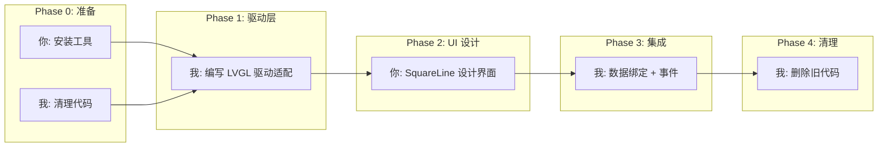
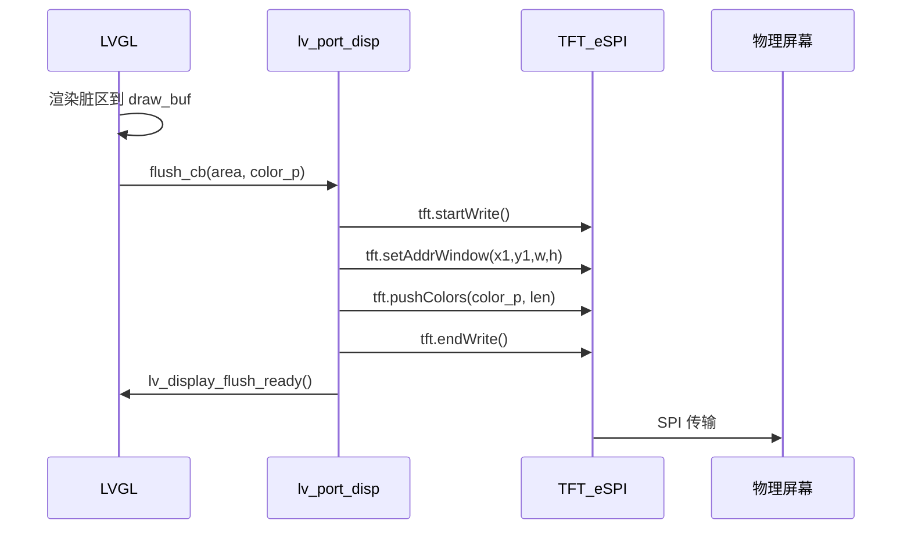
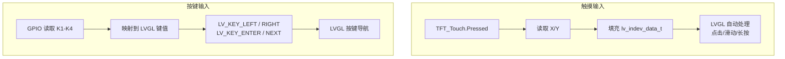
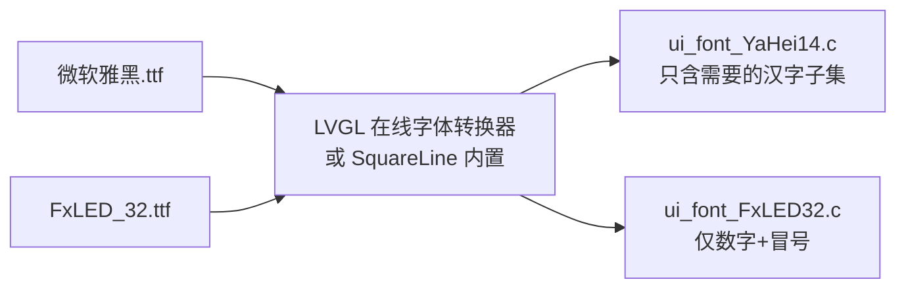
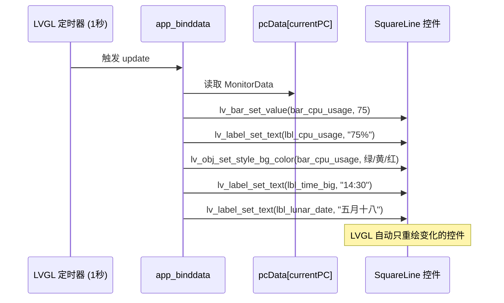
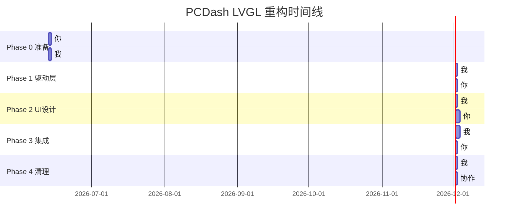

# PCDash LVGL 重构 — 详细实施计划

## 总览：阶段与分工



```
角色图例:
🔵 我（Claude）可以直接做
🟡 你（用户）需要做（GUI 操作 / 硬件测试）
🟢 协作（我提供代码，你验证）
```

---

## Phase 0：环境准备

### Step 0.1 🟡 你：安装 SquareLine Studio

```
1. 下载 SquareLine Studio（免费版即可）
   https://squareline.io/downloads

2. 安装 LVGL 库到 Arduino IDE：
   - Arduino IDE → 工具 → 管理库 → 搜索 "lvgl" → 安装 v9.x
   - 或 PlatformIO: lib_deps = lvgl/lvgl@^9.2

3. 确认 TFT_eSPI 库已安装（你已有）
```

### Step 0.2 🔵 我：代码准备工作

| 任务 | 具体内容 |
|------|---------|
| 删除 ESP8266 兼容代码 | `config.h` 中移除 `#if defined(ESP8266)` 分支及相关 `#ifdef` |
| 创建项目新目录结构 | 建立 `drivers/`、`app/`、`ui/` 目录 |
| 编写 `lv_conf.h` | LVGL 核心配置文件，配置分辨率、色深、内存、字体等 |
| 迁移不变的业务模块 | `data_model.h`、`data_hub.ino`、`serial_recv.ino`、`wifi_client.ino`、`ntp.ino`、`settings.ino` 原样保留 |

---

## Phase 1：LVGL 驱动层对接

> 这一阶段全部由 **🔵 我** 来写代码，**🟡 你** 负责烧录验证。

### Step 1.1 🔵 我：编写 `lv_conf.h`

关键配置项：

```
需要配置的核心参数:
├── LV_COLOR_DEPTH      = 16          (RGB565，匹配 TFT_eSPI)
├── LV_HOR_RES_MAX      = 320
├── LV_VER_RES_MAX      = 240
├── LV_MEM_SIZE          = 48KB       (ESP32) / 可更大(ESP32-S3 PSRAM)
├── LV_FONT_MONTSERRAT_14 = 1        (启用默认英文字体)
├── LV_USE_LOG           = 1          (调试阶段开启)
├── LV_TICK_PERIOD_MS    = 5
└── LV_USE_PERF_MONITOR  = 1          (显示 FPS，调试阶段)
```

### Step 1.2 🔵 我：编写显示驱动 `lv_port_disp.cpp`



核心内容：
- 分配绘制缓冲区（`static lv_color_t buf[320 * 40]`，约 25KB）
- ESP32-S3 有 PSRAM 时用双缓冲
- 实现 `flush_cb` 回调，调用 `tft.pushImage()`
- 背光控制封装

### Step 1.3 🔵 我：编写输入驱动 `lv_port_indev.cpp`



内容：
- 触摸回调 `touchpad_read_cb`：替代当前 `touch.ino` 的全部 75 行
- 按键回调 `keypad_read_cb`：替代当前 `buttons.ino` 的 137 行消抖逻辑
- LVGL 内置消抖和长按检测，不需要手写

### Step 1.4 🟢 协作：验证驱动层

```
验证清单:
├── 屏幕能显示 LVGL 默认控件（一个按钮+一个标签）
├── 触摸点击能响应
├── 按键能导航
├── 背光调节正常
└── FPS 监视器显示 ≥ 25fps
```

**🟡 你负责：** 烧录到 ESP32-S3 开发板，确认以上五项全部通过。
**🔵 如有问题：** 把串口日志贴给我，我来排查。

---

## Phase 2：SquareLine Studio 界面设计

> 这一阶段主要由 **🟡 你** 在 SquareLine 中操作，**🔵 我** 提供详细的控件清单和命名规范。

### Step 2.1 🔵 我：提供 UI 设计规格书

我会给你一份详细的文档，包含：

**项目创建参数：**

```
SquareLine → Create New Project:
  Name:        PCDash
  Resolution:  320 × 240
  Color Depth: 16 bit swap (RGB565)
  Shape:       Rectangle
  LVGL ver:    v9.2
  Template:    Arduino with TFT_eSPI
```

**控件命名规范表（你照着建）：**

```
Screen: scr_main
│
├── pnl_status_bar          (lv_obj,    0,0,    320×16,  bg=#000B)
│   ├── lbl_net_up          (lv_label,  "^0B/s",        绿色)
│   ├── lbl_net_dn          (lv_label,  "v0B/s",        青色)
│   ├── lbl_device_name     (lv_label,  "PC-001",       白色, 居中)
│   └── lbl_conn_type       (lv_label,  "[WiFi]",       浅灰, 右对齐)
│
├── pnl_upper               (lv_obj,    0,16,   320×112)
│   ├── pnl_cpu             (lv_obj,    左半 160×112)
│   │   ├── lbl_cpu_title   (lv_label,  "CPU",          青色)
│   │   ├── bar_cpu_usage   (lv_bar,    0-100)
│   │   ├── lbl_cpu_usage   (lv_label,  "0%")
│   │   ├── bar_cpu_temp    (lv_bar,    0-100)
│   │   ├── lbl_cpu_temp    (lv_label,  "0°C")
│   │   ├── bar_cpu_power   (lv_bar,    0-200)
│   │   ├── lbl_cpu_power   (lv_label,  "0W")
│   │   ├── bar_mem         (lv_bar,    0-100)
│   │   └── lbl_mem         (lv_label,  "0%")
│   │
│   └── pnl_gpu             (lv_obj,    右半 160×112)
│       ├── lbl_gpu_title   (lv_label,  "GPU",          绿色)
│       ├── bar_gpu_usage   (lv_bar)
│       ├── lbl_gpu_usage   (lv_label)
│       ├── bar_gpu_temp    (lv_bar)
│       ├── lbl_gpu_temp    (lv_label)
│       ├── bar_gpu_power   (lv_bar)
│       ├── lbl_gpu_power   (lv_label)
│       ├── bar_gpu_vram    (lv_bar)
│       └── lbl_gpu_vram    (lv_label)
│
├── pnl_lower               (lv_obj,    0,128,  320×104)
│   ├── pnl_clock           (lv_obj,    左半 160×104)
│   │   ├── lbl_date        (lv_label,  "2026/06/12")
│   │   ├── lbl_weekday     (lv_label,  "星期五")
│   │   ├── lbl_time_big    (lv_label,  "14:30",  大字体)
│   │   ├── img_temp_icon   (lv_img,    温度图标)
│   │   ├── lbl_wth_temp    (lv_label,  "28°C")
│   │   ├── lbl_wth_city    (lv_label,  "深圳")
│   │   ├── img_humi_icon   (lv_img,    湿度图标)
│   │   ├── lbl_wth_humi    (lv_label,  "65%")
│   │   └── lbl_wth_desc    (lv_label,  "晴")
│   │
│   └── pnl_lunar           (lv_obj,    右半 160×104)
│       ├── lbl_gz_year     (lv_label,  "丙午年")
│       ├── lbl_gz_md       (lv_label,  "甲午月壬午日")
│       ├── lbl_lunar_date  (lv_label,  "五月十八")
│       └── lbl_jieqi       (lv_label,  "芒种",        黄色)
│
└── pnl_dots                (lv_obj,    底部 320×8)
    ├── dot_0               (lv_obj,    圆形, 7×7)
    ├── dot_1               (lv_obj,    圆形, 7×7)
    └── dot_2               (lv_obj,    圆形, 7×7)
```

### Step 2.2 🔵 我：提供中文字体文件

LVGL 不能直接用 TFT_eSPI 的 `.h` 字体，需要转换：



我会帮你：
- 列出本项目所需的 **最小中文字符集**（农历干支、星期、天气、节气…约 200 字）
- 生成字体转换命令/配置
- 你在 SquareLine 中导入这些字体

### Step 2.3 🟡 你：在 SquareLine 中操作

按照 Step 2.1 的规格表，拖拽创建所有控件。具体步骤：

```
操作流程:
1. 新建项目 → 参数按 Step 2.1
2. 创建 Screen "scr_main"
3. 拖入 Panel → 命名 pnl_status_bar → 设置尺寸/位置/背景色
4. 在 Panel 内拖入 Label → 命名 lbl_net_up → 设置字体/颜色/对齐
5. 重复以上步骤，按规格表建完所有控件
6. 为需要的控件添加事件:
   - pnl_upper 添加 SWIPE_LEFT → 回调名 "on_swipe_left"
   - pnl_upper 添加 SWIPE_RIGHT → 回调名 "on_swipe_right"
7. 导入字体文件 (Step 2.2 提供的 .c)
8. 导入图片资源 (温度/湿度图标)
9. File → Export UI Files → 导出到 PCDash\ui\
```

### Step 2.4 🟢 协作：验证 UI 静态显示

```
你: 将导出的 ui/ 文件复制到项目
我: 编写最小 main.ino 加载 UI
你: 烧录验证 → 屏幕能看到静态布局
```

---

## Phase 3：数据绑定与事件逻辑

> 这一阶段由 **🔵 我** 完成主要代码，**🟡 你** 烧录测试。

### Step 3.1 🔵 我：编写 `app_hal.cpp` — 主循环集成

```
改造 PCDash.ino 的 setup() / loop():

setup():
  EEPROM + settings 初始化     ← 保留不变
  bg_init()                     ← 保留不变
  lv_init()                     ← 新增
  lv_port_disp_init()           ← 新增：显示驱动
  lv_port_indev_init()          ← 新增：输入驱动
  ui_init()                     ← 新增：加载 SquareLine 生成的 UI
  wifi_init()                   ← 保留不变
  app_binddata_init()           ← 新增：初始化数据绑定

loop():
  lv_timer_handler()            ← 新增：LVGL 核心循环（替代 display_update）
  serial_receive()              ← 保留不变
  wifi_poll()                   ← 保留不变
  datahub_checkTimeout()        ← 保留不变
  app_binddata_update()         ← 新增：数据→UI 同步
```

### Step 3.2 🔵 我：编写 `app_binddata.cpp` — 核心绑定



功能映射（替代当前 `ui_draw.ino` + `ui_pages.ino` 的全部功能）：

| 当前代码 | 绑定代码中的对应操作 |
|---------|------------------|
| `_drawUpperPanel()` 里的 `snprintf` + `spr.drawString` | `lv_label_set_text_fmt(lbl_cpu_usage, "%.0f%%", d->cpu)` |
| `ui_drawProgressBar()` 精灵绘制进度条 | `lv_bar_set_value(bar_cpu_usage, d->cpu, LV_ANIM_ON)` |
| `ui_pctColor()` 颜色逻辑 | `lv_obj_set_style_bg_color(bar, color, 0)` |
| `_drawLowerPanel()` 时钟大字 | `lv_label_set_text_fmt(lbl_time_big, "%02d:%02d", h, m)` |
| 农历四行文字 | 4 个 `lv_label_set_text()` |
| `_drawDots()` 指示点 | 修改 `dot_N` 的背景颜色 |
| `display_waitingScreen()` | 切换到等待屏幕或显示/隐藏覆盖层 |
| `display_timeoutScreen()` | 同上 |

### Step 3.3 🔵 我：编写 `ui_events.cpp` — 事件回调

替代当前 `buttons_handleEvents()` + `touch_scan()` 的手势处理：

```
// SquareLine 生成的事件声明（你在 GUI 中添加的）
// 我来写实现:

on_swipe_left   → datahub_nextPC()     // 下一设备
on_swipe_right  → datahub_prevPC()     // 上一设备
on_long_press   → 切换自动轮播         // autoScroll 开/关
on_btn_bright   → 调节亮度             // 亮度步进
```

### Step 3.4 🔵 我：改造 `bg_loader.ino`

```
当前: TJpgDec → tft.pushImage() 直接画到屏幕
改为: 解码 JPEG → lv_img_set_src(img_background, &decoded)
     或: 用 LVGL 的 SJPG 解码器插件直接从文件加载
```

### Step 3.5 🟡 你：分阶段烧录验证

```
验证顺序（每完成一项验证后进入下一项）:

□ 阶段 A: 状态栏正确显示网速/设备名/连接类型
□ 阶段 B: CPU/GPU 数据行 → 进度条动态更新，颜色阈值正确
□ 阶段 C: 时钟大字每秒刷新，日期/星期正确
□ 阶段 D: 天气温湿度 + 城市/描述 + 图标显示
□ 阶段 E: 农历四行文字正确
□ 阶段 F: 滑动切换设备 → 上半区数据变化 + 底部指示点切换
□ 阶段 G: 按键 K1-K4 功能全部正常
□ 阶段 H: 背景图加载和渲染
□ 阶段 I: 主题切换（暗/亮）
□ 阶段 J: 多 PC 自动轮播
```

---

## Phase 4：清理与收尾

### Step 4.1 🔵 我：删除旧代码

```
删除文件:
├── display.ino          (被 lv_port_disp.cpp 替代)
├── ui_draw.ino          (被 SquareLine 生成 + app_binddata.cpp 替代)
├── ui_pages.ino         (同上)
├── touch.ino            (被 lv_port_indev.cpp 替代)
├── buttons.ino          (同上)
├── font/FxLED_32.h      (被 LVGL 字体替代)
├── font/MicrosoftYaheiUI14.h
├── font/city10.h
├── font/tq10.h
├── img/temperature.h    (被 SquareLine 图片资源替代)
├── img/humidity.h
├── tft_setup_st7735.h   (不再支持 ST7735)
└── tft_setup_ili9341.h  (配置移入 lv_conf.h)

清理 config.h:
├── 删除 #if defined(ESP8266) 整个分支
├── 删除 USE_ST7735 相关代码
├── 删除手动 UI 布局常量 (UPPER_Y, LOWER_Y, ROW_H 等)
└── 删除 RGB565 颜色宏 (CLR_xxx，改用 LVGL 颜色 API)

保留不变:
├── config.h (精简后)
├── data_model.h
├── data_hub.ino
├── serial_recv.ino
├── wifi_client.ino
├── ntp.ino
├── settings.ino
└── bg_loader.ino (已改造)
```

### Step 4.2 🔵 我：更新 `EEZStudioProject/` 目录

删除旧的 EEZ Studio 测试项目，避免混淆。

### Step 4.3 🟢 协作：最终回归测试

```
全功能回归测试清单:
├── [启动] 启动画面 → 等待数据 → 收到数据自动切换
├── [串口] 串口 JSON 数据解析和显示
├── [WiFi] WiFi 连接 + HTTP 轮询
├── [NTP]  时间同步 + 时钟显示
├── [天气] 温湿度 + 城市 + 图标
├── [农历] 干支/农历/节气
├── [切换] 触摸滑动切换设备
├── [按键] K1 上一设备, K2 下一设备, K3 切换PC, K4 亮度
├── [长按] K1 自动轮播, K2 主题切换, K4 关背光
├── [背景] 背景图下载/缓存/渲染
├── [超时] 30秒无数据 → 超时画面
├── [重连] WiFi 断开重连
├── [存储] 设置持久化 (亮度/主题/WiFi/IP)
└── [内存] 长时间运行无内存泄漏 (ESP.getFreeHeap 稳定)
```

---

## 时间线估算



**总计约 8-10 天**（穿插进行，非全天投入）

---

## 文件变更总览

```
最终项目结构:

PCDash/
├── PCDash.ino              # 主入口（改造 setup/loop）     [🔵 我改]
├── config.h                # 硬件配置（精简版）             [🔵 我改]
├── data_model.h            # 数据结构                      [不变]
├── lv_conf.h               # LVGL 配置                     [🔵 我写]
│
├── drivers/                #                                [🔵 我写]
│   ├── lv_port_disp.cpp    # 显示驱动
│   ├── lv_port_disp.h
│   ├── lv_port_indev.cpp   # 输入驱动（触摸+按键）
│   └── lv_port_indev.h
│
├── ui/                     #                                [🟡 你导出]
│   ├── ui.h / ui.c         # SquareLine 生成
│   ├── screens.h / .c
│   ├── fonts/              # 转换后的字体
│   └── images/             # 图标资源
│
├── app/                    #                                [🔵 我写]
│   ├── app_binddata.h
│   ├── app_binddata.cpp    # 数据→UI 绑定
│   └── ui_events.cpp       # 事件回调实现
│
├── data_hub.ino            # 数据管理                       [不变]
├── serial_recv.ino         # 串口接收                       [不变]
├── wifi_client.ino         # WiFi 通信                      [不变]
├── ntp.ino                 # 时间同步                       [不变]
├── settings.ino            # 配置持久化                     [不变]
└── bg_loader.ino           # 背景图                         [🔵 我改造]
```

---

## 启动前需要确认的事项

1. **目标平台**：是否只保留 ESP32-S3，还是同时支持 ESP32（无 PSRAM）？
2. **屏幕**：是否只保留 ILI9341 320×240？不再支持 ST7735 160×128？
3. **开发环境**：用 Arduino IDE 还是 PlatformIO？（影响文件结构和 lv_conf.h 放置位置）
4. **LVGL 版本**：用最新的 v9.2 还是更稳定的 v8.4？（SquareLine 对两者都支持）
