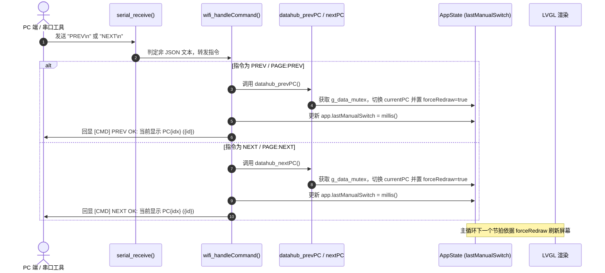

# 实施计划：串口翻页指令控制 (方案 C)

> **变更记录**  
> 日期：2026-11-19  
> 修改模型：Gemini 3.8 Flash  

## 1. 需求与目标
在 PCDash 固件中增加上一页（上一台设备）、下一页（下一台设备）的串口控制指令。  
采用**方案 C（别名兼容最佳方案）**：
- **上一页**：同时支持 `PREV` 与 `PAGE:PREV`（忽略大小写）
- **下一页**：同时支持 `NEXT` 与 `PAGE:NEXT`（忽略大小写）

## 2. 架构与控制时序



## 3. 详细实施步骤

### 步骤 1：修改 `PCDash/wifi_client.ino`
- 在文件顶部前置声明：
  ```cpp
  extern void datahub_prevPC();
  extern void datahub_nextPC();
  ```
- 在 `wifi_handleCommand()` 中添加分支：
  - `cmd.equalsIgnoreCase("PREV") || cmd.equalsIgnoreCase("PAGE:PREV")`
  - `cmd.equalsIgnoreCase("NEXT") || cmd.equalsIgnoreCase("PAGE:NEXT")`
- 执行 `datahub_prevPC()` / `datahub_nextPC()` 并同步更新 `app.lastManualSwitch = millis()`（防止自动轮换立即切换）。
- 友好输出串口回执状态。

### 步骤 2：更新 `readme.md`
- 在“串口配置命令”章节补充 `PREV` / `PAGE:PREV` 与 `NEXT` / `PAGE:NEXT`。

### 步骤 3：更新 `docs/PRD/PCDash_PRD_v1.5.md`
- 在串口命令表格中同步更新指令。

### 步骤 4：验证
- 检查代码语法一致性，确保无宏缺失、语法错误，确保多线程互斥安全。

