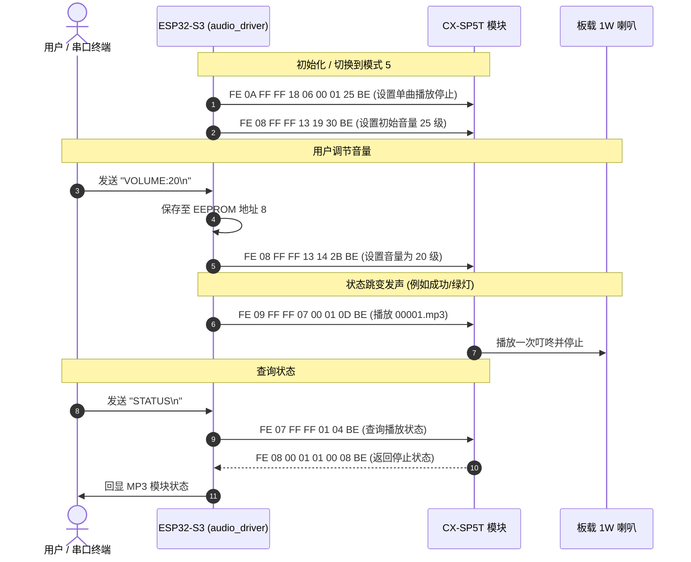

# 实施计划：CX-SP5T 模块全功能适配与双向串口升级

> **变更记录**  
> 日期：2026-11-26  
> 修改模型：Gemini 3.8 Flash  

## 1. 需求与目标
在模式 5（串口 MP3 模式）中，将原通用 DFPlayer 协议更换为宇动创新 **CX-SP5T 模块**的专有双向通信协议（`0xFE ... 0xBE`）：
1. **音频素材生成（方案 A）**：
   - 告警音 `00003.mp3` 内置循环 3 轮急促双嘟（总时长约 1.4 秒），保证各端播放自然循环 3 次。
   - 保留 `00001.mp3`（叮咚双阶梯）与 `00002.mp3`（单声短哔）。
2. **播放循环模式保障**：
   - 模块初始化与切入模式 5 时，主动下发 `0x18` 指令配置播放模式为 `0x06`（单曲播放停止），循环次数为 1，确保每次触发只播一次、播完即停，不依赖模块出厂默认值。
3. **双向串口通信 (UART2)**：
   - 引脚：ESP32 TX (GPIO35) -> 模块 RXD；ESP32 RX (GPIO36) -> 模块 TXD。
   - 波特率：9600 8N1。
   - 接收解析模块状态回传（支持解析查询状态、在线盘符与音量反馈），并在 `STATUS` 命令中展示。
4. **命令行音量控制与持久化**：
   - 支持 `VOLUME:0~30`（及 `VOL:0~30`）串口配置指令。
   - EEPROM 地址 8 持久化保存音量（范围 0~30，默认 25）。
   - 双模统管：模式 5 下发 `0x13` 协议帧调节模块音量，模式 3/4 同步调节 I2S PCM 数字增益。
5. **本地全量编译验证**：
   - 本地 `arduino-cli` 编译 0 报错、0 警告。
6. **文档同步更新**：
   - 更新 `readme.md` 与 `docs/PRD/PCDash_PRD_v1.5.md`。

## 2. CX-SP5T 协议架构

## 3. 详细实施步骤

1. **重新生成音频**：
   - 生成 3 轮循环告警音 `00003.mp3` 并存入 `docs/audio_mp3/`。
2. **数据模型扩展 (`PCDash/data_model.h`)**：
   - 在 `AppState` 中增加 `uint8_t audioVolume`（0~30，默认 25）。
3. **EEPROM 持久化 (`PCDash/settings.ino`)**：
   - 定义 `#define EEPROM_VOLUME_ADDR 8`。
   - `settings_load()` 中读取音量并限制在 0~30，默认 25。
   - `settings_save()` 中保存音量；新增 `settings_saveAudioVolume(uint8_t vol)` 函数。
4. **音频驱动重构 (`PCDash/audio_driver.ino`)**：
   - 适配 CX-SP5T 的 `0xFE ... 0xBE` 协议生成函数 `_send_cx_cmd()`。
   - 实现：
     - `_cx_set_play_mode(0x06, 1)`（单曲播放停止）
     - `_cx_set_volume(vol)`
     - `_cx_play_track(track_num)`
     - `_cx_poll_rx()`：非阻塞接收模块回传帧并更新在线及播放状态。
   - 将模式 3/4（I2S）的振幅缩放与 `app.audioVolume` 绑定；将模式 3/4 告警音也调整为 3 轮双音。
5. **串口命令交互 (`PCDash/wifi_client.ino`)**：
   - 增加 `VOLUME:level` / `VOL:level` 指令解析。
   - 更新 `STATUS` 输出，增加音量显示与 MP3 模块状态。
   - 更新 `HELP` 打印列表。
6. **编译验证**：
   - 调用 `arduino-cli compile` 确保全量编译 0 报错。
7. **文档更新**：
   - 更新 `readme.md` 与 PRD。
